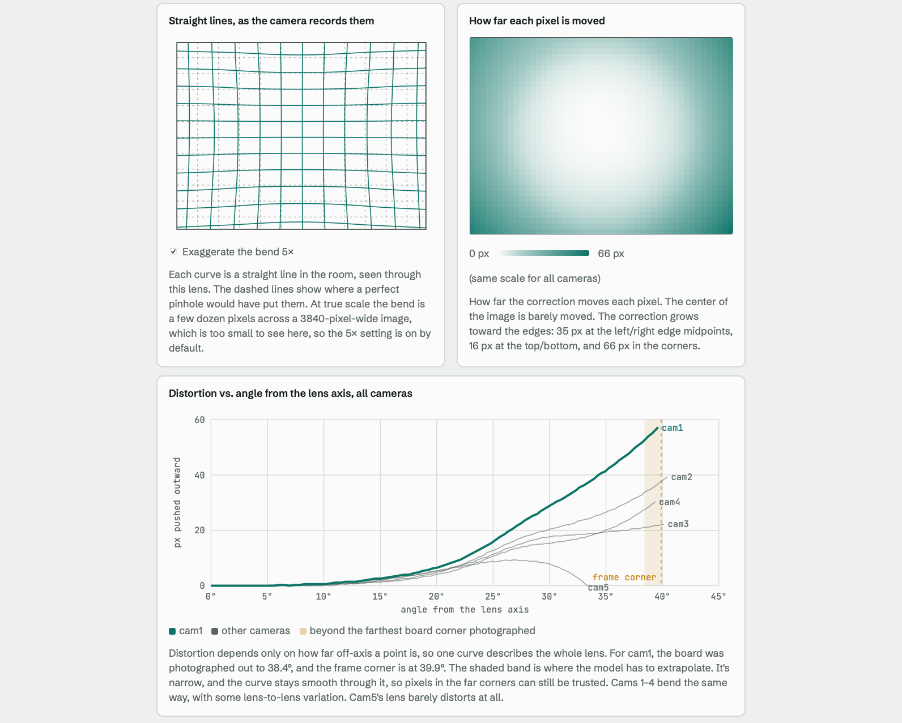

# Camera Calibration

All scripts here run **on your laptop**, connecting to the cameras over SSH.

```
calibration/
├── extrinsic_mark.py        # Step 3 — mark landmark pixels per camera
├── extrinsic_solve.py       # Step 4 — compute rotation/projection matrices
├── ray_utils.py             # Library — pixel → ENU ray, triangulation, ENU↔WGS84
├── pyproject.toml           # Laptop dependencies (opencv-python, numpy)
│
├── intrinsic/
│   ├── capture.py           # Step 1 — capture chessboard photos
│   ├── calibrate.py         # Step 2 — compute K & distortion per camera
│   ├── config.py            # Cameras (host, resolution, flip), timing, health limits
│   ├── cycle.py             # Step 1's green → yellow → red → result capture cycle
│   ├── camera_link.py       # Laptop's connection to one camera, and its health checks
│   ├── camera_node.py       # Runs on each Pi during Step 1 (copied to ~/ifo_capture/)
│   ├── protocol.py          # Messages between camera_link and camera_node
│   ├── remote.py            # SSH: copy/start camera_node, stop/start camera.service
│   ├── render.py            # The preview window
│   ├── cam1/ … cam5/
│   │   ├── captures/        # Raw captured PNGs (auto-populated by Step 1)
│   │   ├── used/            # Move good images here manually before Step 2
│   │   └── result/
│   │       └── intrinsic.json  # Output of Step 2
│
└── extrinsic/
    ├── landmarks.json       # Your real-world landmark definitions (edit this!)
    └── calib.json           # Camera locations + pixel marks + solved extrinsics
```

---

## Prerequisites

```bash
cd camera_nodes/calibration
uv sync          # creates .venv with opencv-python + numpy
```

Cameras must be reachable via SSH:
```bash
ssh cameron@cam1.local
```

---

## Step 1 — Intrinsic Capture

```bash
uv run intrinsic/capture.py            # all cameras: 1-4 (IMX500, 3840×2880) + 5 (kalman's ov5647, 2560×1944)
uv run intrinsic/capture.py --cams 5   # only some cameras
```

- Live quarter-resolution previews appear in a grid, one cell per camera.
- Each cycle works like a traffic light:
  - **Green** (4s): move the board freely.
  - **Yellow** (1s): a capture is coming, so get still.
  - **Red**: capturing, so hold still. Stays up until every camera confirms it grabbed a frame exposed after the request. A camera that can't do that within 0.3s rejects the capture rather than saving a frame taken while you were moving.
  - **Result**: the photo each camera just took, shown for 1.5s after the last one arrives.
- Green only moves on to yellow while every camera is streaming healthily. A camera that is still starting, has stalled, is lagging, or is still sending its last photo holds the cycle at green ("Waiting for cameras", with the reason on that camera's cell). If a camera goes unhealthy during yellow, the capture is called off. A stalled camera's connection is restarted automatically.
- Captured images land in `intrinsic/camX/captures/`.
- Aim for **20–40 diverse captures** per camera (different orientations, distances, corners).
- Press **Q** to quit.

---

## Step 2 — Intrinsic Calibration

1. Review `intrinsic/camX/captures/` and move the **best 20+ images** to `intrinsic/camX/used/`.
2. Run (each camera's images are checked against its `main_size` in `intrinsic/config.py`):

```bash
uv run intrinsic/calibrate.py --board-w 9 --board-h 6 --square-mm 25
```

Adjust `--board-w` / `--board-h` to your board's **interior corner count** (not square count),
and `--square-mm` to your square size. Output: `intrinsic/camX/result/intrinsic.json`.

**RMS reprojection error < 0.5 px is excellent; < 1.0 px is acceptable.**

## Intrinsic Calibration Results

I put together a page with Claude that explains the results of the intrinsic calibration. Check it out here: 
[](https://claude.ai/artifact/G6satGqd396r9zFAK9xC7k)

---

## Step 3 — Extrinsic Landmark Marking

### First: edit `extrinsic/landmarks.json`

Define your landmarks:
```json
[
  {
    "id": "lm1",
    "name": "Bridge South Tower Base",
    "hint": "Click the bottom corner of the tower",
    "world_enu": [120.5, 340.2, 4.0],
    "example_image": "path/to/example.jpg"
  },
  ...
]
```

`world_enu` is **[east_m, north_m, up_m]** offset in metres from your ENU origin.

### Then: edit `extrinsic/calib.json`

Fill in:
- `enu_origin` — lat/lon/alt of your ENU coordinate origin (a fixed reference point)
- `cameras[N].location_enu` — each camera's 3D position as `[east_m, north_m, up_m]`

Measure camera positions with GPS or surveying (±0.5 m accuracy is fine).

### Run the marker:

```bash
uv run extrinsic_mark.py
```

**Controls:**

| Key | Action |
|-----|--------|
| Click | Mark the active landmark |
| N | Next landmark |
| B | Previous landmark |
| `,` | Clear the active mark |
| C | Next camera |
| X | Previous camera |
| Enter | Save all marks |
| Q / Esc | Quit without saving |

---

## Step 4 — Solve Extrinsics

```bash
uv run extrinsic_solve.py
```

Uses OpenCV `solvePnPRansac` (needs ≥ 4 marked landmarks per camera).
Results are written back into `extrinsic/calib.json`:
- `rotation_matrix` — 3×3 R (world ENU → camera frame)
- `camera_matrix` — 3×3 K (from intrinsic calibration)
- `projection_matrix` — 3×4 P = K[R|t]

---

## Using the Calibration (pixel → 3D ray)

```python
from calibration.ray_utils import load_all_cameras, ray_from_camera, triangulate_rays

cameras = load_all_cameras()   # loads extrinsic/calib.json

# Get ENU ray from a detected pixel on camera 1
origin, ray = ray_from_camera(cameras[1], u=2028, v=1520)

# Triangulate from two cameras
origins    = [o1, o2]
directions = [r1, r2]
point_enu, residual_m = triangulate_rays(origins, directions)
print(f"Object at ENU {point_enu}, ray miss distance {residual_m:.2f}m")

# Convert to lat/lon for mapping
from calibration.ray_utils import enu_to_wgs84
lat, lon, alt = enu_to_wgs84(*point_enu, origin_lat=40.7128, origin_lon=-74.0060, origin_alt=0.0)
```

---

## ENU Coordinate System

- **Origin**: the `enu_origin` point in `calib.json`
- **X (East)**: positive eastward, metres
- **Y (North)**: positive northward, metres
- **Z (Up)**: positive upward, metres
- Valid for areas < ~5 km across (flat-Earth approximation)
- Convert to WGS84 at any point using `enu_to_wgs84()` in `ray_utils.py`
